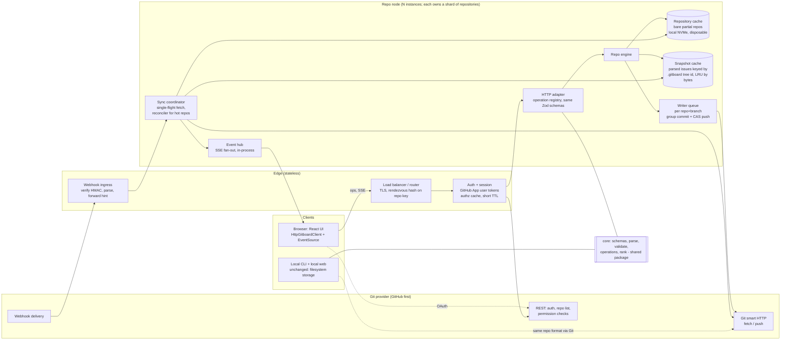
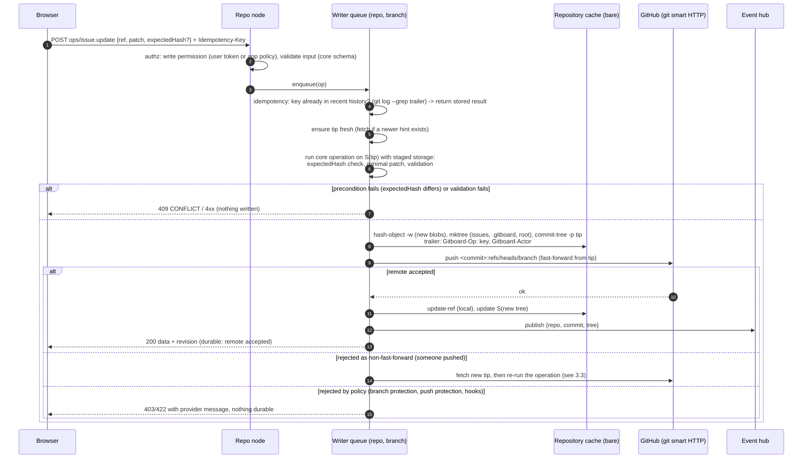

# B. Proposed high-level architecture

> **Partly replaced (2026-11-21).** The requirements changed to a self-hosted, multi-user server for any Git remote. Where this document conflicts with [07 Self-hosted architecture](07-self-hosted-architecture.md), 07 wins. This text remains the analysis of the provider-hosted (SaaS) variant.

Part of [FEAT-8c2e32c](README.md). Status: **proposed**, not approved. Decision records: [ADR index](README.md#decision-records).
Labels: **[F]** fact, **[A]** assumption, **[E]** estimate, **[R]** recommendation (see [A. current architecture](01-current-architecture.md)).

## 1. Summary of the design, and where it differs from the brief

The brief proposes: *stateless API + Git workers + ephemeral repository workspaces + shared Git object caching + webhook-driven
synchronization*. After reading the code, the recommendation keeps the direction (server-side Git, Git authoritative, webhooks as
the primary sync trigger, SSE) and changes four things.

| # | Brief | Recommendation | Why (short) |
|---|---|---|---|
| 1 | Ephemeral **worktrees** (or clones) for writes | **No working trees at all.** Bare, partial repository caches; reads via `cat-file`/`ls-tree`; commits built with plumbing (`hash-object`, `mktree`, `commit-tree`) and pushed with a compare-and-swap push | A worktree buys nothing: operations are text patches on one to a handful of small files. It costs checkout I/O, adds locking and cleanup, and, most importantly, **materialising untrusted repository content on a shared server is the largest security surface** (checkout-time CVE class, filters, symlinks, submodules). [R] |
| 2 | Parallel preparation in independent workspaces, "worktree pool" | **One writer per `(repo, branch)` with write coalescing (group commit)**; preparation is in-memory and microseconds, so there is nothing to parallelise | Parallelism is useless where the serialisation point is the *push*, and naive parallel pushes degrade to O(W²) attempts for W writers (see [C](03-scalability-and-limits.md#4-write-throughput-and-contention)). [R] |
| 3 | Five separable components: API, Git workers, cache/storage nodes, sync workers, real-time delivery | **One node type** ("repo node") that owns a shard of repositories and contains the Git engine, cache, sync and SSE fan-out; stateless API/edge in front; routing by repository (rendezvous hashing). Separate processes only when a measured need appears | Cache locality is the whole performance story; separate cache nodes mean network filesystems or remote object access, which are slower and less safe for Git. Sync and SSE need the same state (current revision) the reader has. [R] |
| 4 | Webhook-driven synchronisation | Webhooks are **hints** that name a new revision; fetching is **demand-driven** (hot repos eagerly, cold repos not at all); a low-rate reconciler covers lost hints | Sync cost then scales with *active* repositories, not total repositories or total pushes. [R] |

What the brief fixes and this design keeps: Git is the only authoritative store; GitHub REST/GraphQL is not on the primary data
path; a write is acknowledged only after the remote accepted it; caches are rebuildable; the CLI keeps its filesystem implementation.

## 2. Component diagram



### Responsibilities

| Component | Responsibility | State | Scales by |
|---|---|---|---|
| **Edge / router** | TLS, request routing by `repoKey = provider:repoId` using rendezvous (highest-random-weight) hashing over the live node set; health-aware; sticky for SSE | none | replicas |
| **Auth + session** | GitHub App user-to-server OAuth; encrypted session cookie (no server-side session store at first); per-request authorisation (cached, TTL ≤ 60 s, see [security](04-security-and-tenancy.md)) | encrypted cookie | replicas |
| **Webhook ingress** | Verify `X-Hub-Signature-256`, parse `push`/`installation*` events, forward a *revision hint* `(repoKey, ref, after-oid, touchesGitboard?)` to the owning node; always respond fast (< 10 s limit) | none | replicas |
| **HTTP adapter (new)** | Third adapter over `executeOperation`-style dispatch, using the existing operation schemas and error table; adds tenancy, revision headers, idempotency keys | none | with node |
| **Repo engine** | The only component that touches Git: read path, write path. Exposes a *storage* implementation to core (snapshot read + staged writes + commit), see ADR *Storage seam* | in-memory | with node |
| **Repository cache** | One **bare** repo per `(repoKey)` on node-local disk, created by `git init --bare` + blobless fetch of the board branch; leases, idle expiry, size-based eviction. Never holds uncommitted state | disk, disposable | add nodes |
| **Snapshot cache** | Immutable parsed view of `.gitboard/` keyed by the **tree id of `.gitboard`** (code-only pushes do not change it). Updated incrementally via tree diff | memory, rebuildable | add nodes / memory |
| **Writer queue** | Per `(repo, branch)`: serialises, coalesces and retries writes; owns push; enforces idempotency via commit trailers | memory | with node (shard by repo) |
| **Sync coordinator** | Turns hints into fetches (single-flight per repo), updates snapshot, emits events; reconciler probes hot repos; backoff on provider errors | memory | with node |
| **Event hub** | SSE fan-out of `{repo, branch, commit, tree}` hints to subscribed browsers; `Last-Event-ID` replay is unnecessary because events are idempotent hints | memory | with node |
| **Metadata store (deferred)** | Only introduced when cross-node state is needed (see ADR *Database-free issue storage*). **Never** holds issue data | n/a | n/a |

### Why not separate Git workers and cache nodes now

*Stateless API + separate Git workers* needs the worker to have the repository cache. Either the cache is local to the worker (then the
worker *is* the repo node and routing by repo is mandatory anyway) or it is shared (NFS/EFS/object storage), which makes every `git`
invocation pay network-filesystem latency, weakens Git's file locking and removes the isolation boundary. **[R]** Keep one node type, route by
repository, keep module boundaries (`engine`, `sync`, `hub`) clean so a split is a deployment change later.

## 3. Request flows

Notation: **tip** = current commit of the board branch as known to the node; **S(tip)** = snapshot of `.gitboard/` at tip.

### 3.1 Reading a board

```mermaid
sequenceDiagram
  autonumber
  participant U as Browser
  participant E as Edge/router
  participant N as Repo node (owner of repo)
  participant S as Snapshot cache
  participant R as Repository cache (bare)
  participant G as GitHub (git smart HTTP)

  U->>E: POST /api/repos/{repoKey}/ops/board.get (session cookie)
  E->>E: authenticate; authz cache (TTL<=60s) else REST permission check with user token
  E->>N: route by rendezvous hash(repoKey)
  N->>N: freshness policy: last verified tip age < T_fresh and webhook channel healthy?
  alt tip is fresh enough
    Note over N: no network call to the provider
  else stale or unknown
    N->>R: cache present?
    alt cache missing (cold start)
      N->>G: git init --bare; fetch --filter=blob:none (board branch; one-shot --depth=1 only for huge repos)
      N->>G: ONE batched fetch of the .gitboard blobs by object id (lazy per-blob fetch would spawn one fetch per blob)
    else cache present
      N->>G: probe/fetch board branch (single-ref refspec fetch, protocol v2 ref-prefix); single-flight per repo
    end
  end
  N->>R: rev-parse tip^{tree}, ls-tree .gitboard -> tree id T
  N->>S: lookup(T)
  alt hit
    S-->>N: parsed snapshot
  else miss
    N->>R: diff-tree(old T, new T) -> changed blobs (or full read on first load)
    N->>R: cat-file --batch (changed blobs only)
    N->>N: parse + validate using core (parseIssueText, config)
    N->>S: store(T)
  end
  N->>N: core board.get over S(T)
  N-->>U: 200 data + ETag: T, X-Gitboard-Revision: commit, verifiedAt
```

Notes. **[R]** Freshness is *communicated*, not guaranteed: every read response carries the commit and tree it was served from and when
the tip was last verified. A client may send `If-None-Match: T` and receive `304` after a hint. `fresh=strict` forces a ref probe
(used right after a write by another tab, or by "refresh" in the UI).

### 3.2 Updating an issue



The 200 means *the remote ref now contains the commit*. If the process dies after the push but before the reply, the client retries with the
same idempotency key and the queue finds the trailer in history and answers without writing again.

### 3.3 Handling parallel writes

```mermaid
sequenceDiagram
  autonumber
  participant A as Writer A
  participant B as Writer B
  participant C as Writer C
  participant Q as Writer queue (repo, branch)
  participant G as GitHub
  participant X as Another Git client

  A->>Q: op A
  B->>Q: op B (same issue as A, no precondition)
  C->>Q: op C (same issue, expectedHash from before A)
  Note over Q: group commit: take all queued ops, apply in arrival order on the same tip
  Q->>Q: A -> commit c1 (tip..c1)
  Q->>Q: B -> re-reads patched file, applies its keys only -> commit c2 (disjoint fields merge)
  Q->>Q: C -> expectedHash mismatch -> rejected 409, no commit
  X->>G: push (external commit e1 on the same branch)
  Q->>G: push c2 as branch tip (parent chain tip,c1,c2)
  G-->>Q: rejected: non-fast-forward
  Q->>G: fetch (incremental)
  Q->>Q: semantic retry: re-run A and B against new tip e1 (not a textual rebase)
  Q->>G: push (tip e1, c1', c2')
  G-->>Q: accepted
  Q-->>A: 200
  Q-->>B: 200
  Q-->>C: 409 conflict (reload and retry)
  Note over Q: bounded retries with jitter; after the limit return 503 Retry-After. Never force-push.
```

Key properties **[R]**:

- **Correctness never depends on routing.** If two nodes believe they own a repo (during a rebalance), both push; Git's non-fast-forward
  rejection is the compare-and-swap; the loser re-fetches and re-runs. Affinity only removes contention.
- **Semantic retry, not textual rebase.** On rejection the *operation* is re-executed against the new tip. Because writes are minimal key patches
  (`parse.ts applyChanges`), concurrent edits to different fields of one issue both survive. The same field edited by two writers: last writer wins
  *unless a precondition (`expectedHash`) was supplied*, in which case the later one gets `CONFLICT`. User-initiated edits from the UI already send
  `expectedHash`.
- **Multi-file operations are atomic** (one commit): rank rebalance, unlink children, column remap.
- **Conflicting external edits are never overwritten.** Because the push is a fast-forward-only CAS, an external commit is always incorporated before ours.

### 3.4 Processing an external Git push

```mermaid
sequenceDiagram
  autonumber
  participant D as Developer (CLI / git / other client)
  participant G as GitHub
  participant W as Webhook ingress
  participant N as Repo node (owner)
  participant R as Repository cache
  participant H as Event hub
  participant U as Browser (subscribed)

  D->>G: git push (touches .gitboard/issues/x.md)
  G->>W: POST push event (HMAC, X-GitHub-Delivery)
  W->>W: verify signature (constant time), ignore non-board refs, cheap parse
  W-->>G: 202 (well under 10 s)
  W->>N: hint {repoKey, ref, after, touchesGitboard, truncated?}
  N->>N: repo hot (cache present or subscribers)? if cold: record latest known oid only, stop
  N->>N: if payload proves .gitboard untouched and not truncated: record oid only, no fetch, no event
  N->>R: single-flight incremental fetch of ref (coalesces bursts)
  N->>R: new tip -> tree id of .gitboard; if unchanged: stop
  N->>R: diff-tree old..new, read changed blobs, update snapshot (incremental)
  N->>H: publish {repo, commit, tree}
  H-->>U: SSE event: changed {commit}
  U->>N: refetch affected data (If-None-Match: tree)
  Note over N: delayed or lost webhook: reconciler (hot repos) and read-time freshness probe converge to the same state
```

### 3.5 Cache expiration and cold-start recovery

```mermaid
sequenceDiagram
  autonumber
  participant J as Janitor (per node)
  participant R as Repository cache
  participant U as Request (later)
  participant L as Cache manager (lease table, in memory)
  participant G as GitHub

  loop every minute
    J->>L: repos with no lease and idle > T_idle (default 30 min [A])
    J->>R: delete directory (nothing to flush: no unpushed state ever lives here)
    J->>R: also evict LRU when disk > high-water mark; recreate bloated caches (>X MB or >Y fetches)
  end
  U->>L: acquire lease(repoKey)
  alt cache absent (expired, evicted, node replaced, or rehashed)
    L->>L: single-flight per repoKey (other requests wait on the same promise)
    L->>G: git init --bare; fetch --filter=blob:none <board branch> (one-shot --depth=1 only for huge repos)
    L->>G: batch-fetch blobs under .gitboard/
    L-->>U: ready (cold-start latency, see C)
  else present
    L-->>U: ready (warm)
  end
  Note over L,G: failure during cold start: delete partial directory, return 503 + Retry-After; no partial cache is ever served.<br/>Provider outage with warm cache: reads served from cache marked stale; writes fail fast.
```

## 4. Interfaces that must exist (names are illustrative)

These are the seams; they are listed to make the ADRs reviewable, not as an implementation plan.

- **`RepoSnapshot`** (core, read-only): `config(): ConfigFile`, `issueIds()`, `readIssue(id): FileContent`, `readAllIssues()`, plus `revision`
  (`commit`, `tree`). Implementations: filesystem (CLI, today's code) and Git-object (hosted).
- **`RepoTransaction`** (core, write): `stageIssue(id, text, expectedHash)`, `stageCreate`, `stageDelete`, `stageConfig`, `commit(message, trailers)`.
  Filesystem implementation applies immediately/atomically as today; the Git implementation collects the change set and builds one commit.
- **`GitStore`** (hosted engine): `ensure(repoKey, branch)`, `fetch(...)`, `readTree`, `readBlobs`, `commit(changes)`, `pushCas(...)`. One implementation using the system `git`.
- **`GitboardClient`** (web, existing): unchanged shape; new `HttpGitboardClient` base path with tenancy; `subscribe` receives the revision.
- Wire additions: `X-Gitboard-Revision`, `ETag`, `Idempotency-Key`, error codes `STALE_REVISION`, `PUSH_REJECTED`, `RETRY_LATER`.

## 5. Failure behaviour (summary; quantification in [C](03-scalability-and-limits.md#10-failure-modes))

| Failure | Behaviour |
|---|---|
| GitHub unreachable or throttling | Reads from warm cache, labelled stale with age; cold reads fail with 503; writes fail with 503 and `Retry-After`; no write-behind queue exists (would violate "not durable until pushed") |
| Node crashes mid-write | Nothing was acknowledged; client retries with the same idempotency key; trailer lookup prevents double application if the push had landed |
| Node lost / rebalanced | Rendezvous hashing moves only that node's repos; new owner cold-starts them; no data is lost because no state is authoritative on a node |
| Missed webhook | Read-time freshness probe and hot-repo reconciler converge; staleness bounded by the probe interval |
| Push rejected by policy | Surfaced as a distinct error with the provider's message; nothing durable; client may switch to PR mode if configured (OQ-1) |
| Branch force-pushed or history rewritten | Fetch uses forced update of the local tracking ref; snapshot keyed by tree id is unaffected; no assumption of linear history |
| Poisoned or oversize repo | Per-repo CPU, memory, disk and time limits in a sandboxed Git subprocess; repo quarantined after repeated breaches |
