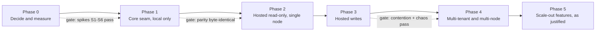

# F. Implementation roadmap (high level)

> **Partly replaced (2026-11-21).** The requirements changed to a self-hosted, multi-user server for any Git remote. Where this document conflicts with [07 Self-hosted architecture](07-self-hosted-architecture.md), 07 wins. This text remains the analysis of the provider-hosted (SaaS) variant.

Part of [FEAT-8c2e32c](README.md). Phased migration from the local-only implementation to the hosted architecture. This is a sequencing
and validation plan, not a task breakdown. Everything is **proposed**; phases are gated by the decisions in the [ADRs](README.md#decision-records)
and the [open questions](05-open-questions.md).

Principle: **every phase leaves the local CLI and local web app working and byte-compatible** (the parity tests are the guard).

## Phase 0: Decide and measure

- **Goal.** Turn the *assumptions* in this analysis into measurements and settle the P0 questions (OQ-1 to OQ-4).
- **Work.** Spikes against throwaway repositories on a real GitHub account (no product code):
  - **S1 Cold start and object sizes:** `--depth=1 --filter=blob:none` vs `tree:0` vs full, on repos with 1k, 100k and 1M files and long history; time and bytes; batch blob prefetch behaviour.
  - **S2 Issue-count scaling:** 1k / 10k / 100k issue files: tree size, push size, parse time, snapshot memory, `diff-tree` incremental update time.
  - **S3 Contention:** W = 10/50/100 concurrent pushers to one branch, naive CAS-retry vs queue + group commit; observe GitHub behaviour (rejections, throttling messages).
  - **S4 Provider policies:** pushes with a GitHub App token to protected branches, rulesets with required signed commits, secret-scanning push protection; error texts and bypass options.
  - **S5 Webhook latency and loss:** delivery latency distribution, behaviour on timeouts and redelivery.
  - **S6 Sandboxing:** cost of per-process isolation for `git` (uid, namespaces, rlimits) on the target platform.
- **Dependencies.** A GitHub App for testing; a Linux test host.
- **Risks.** S4 reveals that common repository policies block App pushes (changes the product promise); S1/S2 show cold start or tree size above targets (pushes OQ-7 and OQ-1 Option 3 forward).
- **Validation milestone.** Written spike results appended to [C](03-scalability-and-limits.md) replacing the corresponding assumptions; OQ-1..OQ-4 recorded as accepted/rejected ADRs.

## Phase 1: Core storage seam (local only)

- **Goal.** Introduce `RepoSnapshot` / `RepoTransaction` (ADR *Storage seam*) with the filesystem implementation behind them; allow reusing a parsed snapshot across calls; make multi-file operations stage their writes.
- **Dependencies.** OQ-3 decided.
- **Risks.** Regressions in the byte-exact write behaviour (ADR-7a20520); accidentally changing partial-failure semantics of multi-file operations (they become *more* atomic on Git, equivalent on FS).
- **Validation milestone.** All existing tests pass unchanged; `tests/parity.test.ts` byte-identical; a new benchmark shows `issue.get`/`issue.update` no longer scan all files when given a snapshot; ESLint boundaries extended (core still imports no `node:fs` outside `storage`, and nothing Git-specific).

## Phase 2: Hosted read-only on a single node

- **Goal.** A logged-in user sees boards of repositories in their GitHub App installations, with near-real-time updates; no writes yet.
- **Includes.** GitHub App and OAuth; session handling; repository cache manager (bare partial/shallow, leases, eviction); Git object read engine; snapshot cache keyed by tree id; webhook ingress with signature verification and hints; SSE; HTTP adapter with tenancy and revision headers; read-only operations only (`surfaces` flag distinguishes); authorisation cache and revocation handling (OQ-9, OQ-15).
- **Dependencies.** Phase 0 results, Phase 1 seam, OQ-5 (credential storage), OQ-9.
- **Risks.** Cold-start latency on large repos; authorisation leaks between tenants (the cache directory and the snapshot cache must be keyed by tenant-qualified repo identity); webhook secret/app key handling.
- **Validation milestone.** Read p95 targets met on warm cache for 10k issues; cold-start p95 measured and documented; an external `git push` appears in a subscribed browser within the target; killing the node loses nothing; revocation drill (remove repo from installation: access denied within the TTL, cache deleted).

## Phase 3: Hosted writes

- **Goal.** Create/update/move/delete issues from the hosted UI with durable, conflict-safe semantics.
- **Includes.** Plumbing commit builder; compare-and-swap push; per-(repo, branch) writer queue with group commit; semantic retry; idempotency via commit trailers; error mapping for protected branches / push protection / signature rules (OQ-1, OQ-2, OQ-4); `repo.init` as a commit (OQ-14); commit message and trailers (OQ-6).
- **Dependencies.** Phase 2; OQ-1, OQ-2, OQ-4 decided.
- **Risks.** Provider push throttling under bursts; provider policies rejecting pushes; subtle semantic-retry bugs (a re-executed operation must re-check *all* invariants, e.g. id uniqueness, parent exists, status valid in the new config).
- **Validation milestone.** Contention test W=100 on one branch completes with bounded attempts per success (target well under 2, versus W/2 for naive retry); chaos tests (kill -9 before push, after push before ack, network partition during push) never lose or duplicate an acknowledged write; an external push racing a write is never overwritten; a pushed secret in an issue body produces a clear, non-durable failure; CLI-created and hosted-created issues interoperate in both directions.

## Phase 4: Multi-tenant hardening and multi-node

- **Goal.** Run untrusted repositories for many tenants on several nodes.
- **Includes.** Process sandboxing and resource limits (OQ-8); rendezvous routing and rebalancing; per-tenant quotas and concurrency limits; global backpressure and load shedding; observability (per-repo and per-tenant metrics, push/fetch latency, cache hit rate, queue depth); disk high-water eviction; node drain procedure.
- **Dependencies.** Phase 3; S6.
- **Risks.** Thundering herd of cold starts after a node loss; noisy neighbours; operational complexity of rebalancing.
- **Validation milestone.** Node-loss drill (repos re-homed, no data loss, cold-start storm absorbed by single-flight and concurrency caps); noisy-neighbour test (one tenant with a huge repo does not degrade others beyond defined bounds); malicious-repository test suite (oversize objects, deep trees, pathological packs, hostile `.gitattributes`/`.gitmodules` content: nothing executes, limits trip cleanly).

## Phase 5: Scale-out features, each only on evidence

- Separate API frontends from repo engines (needs event bus, OQ-11).
- Derived search/aggregation index built from snapshots (OQ-12; conditions in the ADR).
- PR-based write mode for strictly protected branches (OQ-1 Option 4).
- Sharded issue directory format v2 if S2 or production data justify it (OQ-7).
- Second provider (OQ-10).
- Dedicated nodes for large tenants.

## Cross-cutting risks

| Risk | Impact | Mitigation |
|---|---|---|
| Provider policies block App pushes on many repos | Product promise (write from hosted UI) fails for them | S4 early; read-only mode with clear message; OQ-4 fallback |
| Hidden provider throttling of Git traffic (not documented as numeric quota) | Burst writes/fetches degrade unpredictably | Per-repo and global concurrency caps, jittered retries, honouring `Retry-After`, metrics on provider errors; S3 |
| Format decisions made by accident (flat dir, commit-per-op) | Hard to reverse | ADRs flag them explicitly; OQ-7 decision gate |
| Scope creep into a database-centric design | Two sources of truth | ADR *Database-free issue storage* with explicit admission criteria |
| Security regression from adding checkout-based features later (e.g. "download as zip") | Reopens the checkout CVE class | ADR *Repository caches* forbids working trees; any exception needs its own ADR |
