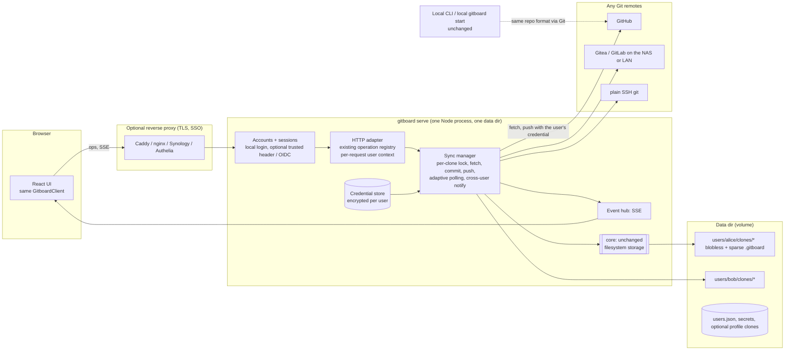
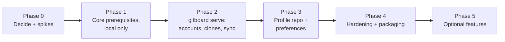

# G. Revised direction: self-hosted, multi-user, any Git remote

Part of [FEAT-8c2e32c](README.md). Date: 2026-11-21. Status: **proposed**. This document **supersedes the provider-hosted (SaaS) design in documents 02-04 and 06 where they conflict**;
those remain as the analysis of the SaaS variant. Document 01 (current architecture) is unchanged and is *more* relevant now. Labels: **[F]** fact, **[A]** assumption, **[E]** estimate, **[R]** recommendation.

## 1. What changed in the requirements

| Before (docs 02-06) | Now |
|---|---|
| Operated by us for many tenants, GitHub first (GitHub App, webhooks, provider quotas) | **Self-hosted** by anyone (the owner's NAS first): one instance serves a handful to a few dozen users; scale comes from many independent deployments, not from one big one |
| No checkouts; bare caches, plumbing commits | **Clones and working trees are acceptable** and reuse the existing filesystem core unchanged |
| Identity = GitHub App; users = GitHub users | **Instance accounts** (log in to the Gitboard app); Git access via **per-user credentials** for any remote (GitHub, GitLab, Gitea, plain SSH on the NAS) |
| Per-user state in provider/session | **Per-user settings**: some versioned in the repository (`.gitboard/config.yaml`), some per user, optionally in the user's **own Git "profile" repository** (their remotes, preferences) |

Unchanged principles: **Git is the source of truth**; a write is acknowledged only after the remote accepted it; no silent overwrite of external changes; the local CLI and local `gitboard start` keep working and stay format-compatible; no database for issue data.

## 2. Impact on the earlier analysis

| Earlier proposal | Status under the new requirements (none was ever accepted) |
|---|---|
| Git authoritative (ADR-7955eb5) | **Kept** |
| No database for issue data (ADR-099d4df) | **Kept**; a small file-based account store is *not* a database of issues |
| SSE with idempotent hints (ADR-3f39a2f) | **Kept** (events now come from instance-local sync, and the existing watcher can be reused) |
| Tree-keyed snapshot cache (ADR-dc3a07e) | **Kept as an optional later optimisation**; the baseline is today's file reads |
| Git transport, not provider APIs (ADR-b33c5a6) | **Rejected** (requirements changed): any Git remote with per-user credentials; no provider API is needed on any path |
| Bare caches, no worktrees (ADR-0495ea1); plumbing CAS writes (ADR-6f6fd0c) | **Rejected** (requirements changed): managed clones with working trees; writes are *operation, commit, push* |
| Coalescing, governor, rendezvous sharding (ADR-db6547a, ADR-375920a) | **Rejected** (requirements changed): one process, in-process locks; coalescing deferred |
| Webhook-first sync (ADR-82e7ef1) | **Rejected** (requirements changed): NAS is usually unreachable by webhooks; adaptive polling plus instance-local notification; webhooks optional |
| GitHub App tenancy (ADR-79c71bc) | **Rejected** (requirements changed): accounts, sessions, per-user credentials, SSRF and hardening |
| Core storage seam (ADR-9eb2543) | **Rejected** (requirements changed): not needed, the filesystem core is used as is; the needed core change is much smaller (§4.4) |

## 3. Proposed architecture



### 3.1 Components

| Component | Responsibility | State |
|---|---|---|
| **`gitboard serve`** (new command; `start` stays loopback-only and single-user) | Runs the server for several users. Refuses a non-loopback bind unless authentication is enabled | process |
| **Accounts and sessions** | Local accounts (password hashed with `scrypt` from `node:crypto`, no new dependency), first-run admin, registration closed by default (admin creates or invites). Signed, HttpOnly, SameSite cookies. Optional trusted-header or OIDC login for NAS SSO (Authelia, Synology SSO) | `users.json` in the data dir (atomic writes) |
| **Credential store** | Per-user Git credentials: an app-generated ed25519 SSH key (public key shown to add to the remote) and/or an HTTPS token. Encrypted at rest (AES-256-GCM) with an instance master key from an environment variable or key file; never returned by the API, never logged, never in the profile repo | encrypted files |
| **HTTP adapter** | Mounts the existing operation registry; resolves the *user's* repository list and clone path per request (§4.4) | none |
| **Sync manager** | Owns every Git network action and the clone's working tree: per-clone read/write lock, `fetch`, fast-forward, commit, push, retry; adaptive polling; in-process fan-out when one user's push affects other users' clones of the same remote branch | in-memory locks and timers |
| **Managed clones** | One clone per (user, repository) under `users/<user>/clones/`: `--filter=blob:none`, `--no-checkout` then cone sparse-checkout of `.gitboard/`, hooks disabled. Server-owned: the working tree is always clean between operations | disk (rebuildable) |
| **Profile** | Per-user settings, optionally a Git repository (§5) | profile clone |
| **Core, CLI, web** | Unchanged business logic and formats | n/a |

### 3.2 Worktrees and clones

Per-user clones make worktrees optional, not required. Options (open question SH-1):

- **S1 (recommended baseline): independent clone per (user, repository).** Strongest credential isolation (each clone is fetched and pushed with its owner's credential; a user can only ever see what their own credential can fetch), simplest locking, trivially disposable. Cost: disk and fetch duplication. With blobless + sparse clones a typical clone is a few MB [E], so 50 users x 50 repositories is on the order of 7 GB [E]; large repositories dominate (their trees; see §7).
- **S3: one shared bare object store per remote, per-user `git worktree`s.** Saves disk and network when many users share large repositories. Needs care: objects fetched with user A's credential become readable through user B's worktree, so the server must prove B's access (a successful authenticated fetch/ls-remote with B's credential) before B's worktree is ever created or updated, and shared-store fetches need per-remote locking. A worktree also cannot check out a branch that another worktree has checked out (use a per-user local branch tracking the board branch). Worth it only when measurement shows duplication hurts (spike S2).
- **Temporary worktrees** remain the right tool for the optional PR mode (write on a short-lived branch and push it), a Phase 5 feature.

### 3.3 Write flow

```mermaid
sequenceDiagram
  autonumber
  participant U as Browser (Alice)
  participant A as HTTP adapter
  participant S as Sync manager
  participant W as Alice's clone (working tree)
  participant R as Git remote

  U->>A: POST ops/issue.update (session cookie)
  A->>A: authenticate; resolve Alice's repo + clone; validate input (core schema)
  A->>S: run(clone, op)
  S->>S: acquire clone write lock; remote-branch push mutex (in-process)
  S->>R: fetch (skipped if verified within the freshness window)
  S->>W: fast-forward to origin/branch (clone is clean, so always possible)
  S->>W: executeOperation (existing core: expectedHash check, minimal patch, validation)
  alt precondition or validation fails
    S->>W: restore working tree (git checkout -- .gitboard; git clean)
    S-->>U: 409 / 4xx (nothing written)
  else
    S->>W: git add .gitboard; git commit (author = Alice, trailer Gitboard-Op)
    S->>R: git push (fast-forward only, Alice's credential)
    alt accepted
      S-->>U: 200 (durable: the remote has it)
      S->>S: notify other subscribed clones of the same remote branch; SSE
    else rejected as non-fast-forward (someone else pushed)
      S->>W: git reset --hard origin/branch (drop the unpushed commit)
      S->>R: fetch
      S->>W: re-execute the operation on the new tip (semantic retry, bounded, jittered)
    else rejected by policy (protected branch, hook, auth)
      S->>W: reset to origin/branch
      S-->>U: 403/422 with the remote's message, nothing durable
    end
  end
```

Properties: the existing operations are reused verbatim; a multi-file operation becomes one commit (atomic); a crash leaves at most an unacknowledged local state that startup recovery resets (clones are server-owned, so this is safe); the same-instance contention between users is removed by the in-process push mutex per remote branch, while external pushers are handled by the non-fast-forward rejection (correctness never depends on the mutex).

### 3.4 Sync and real-time

```mermaid
sequenceDiagram
  autonumber
  participant B as Bob's browser (open board)
  participant S as Sync manager
  participant WB as Bob's clone
  participant R as Git remote
  participant X as Anyone else (CLI, other client)

  Note over S: clones with an open SSE subscriber are polled; idle clones are not
  loop adaptive interval (for example 15 s active, backing off to 5 min when nothing changes)
    S->>R: single-ref fetch (Bob's credential), bounded concurrency
  end
  X->>R: git push (touches .gitboard)
  S->>R: next poll sees new tip
  S->>WB: fast-forward (clean tree)
  WB-->>S: file changes (existing watcher) or explicit event
  S-->>B: SSE: changed
  B->>S: refetch ops (existing client behaviour)
  Note over S: a push made through this instance triggers an immediate fetch for other subscribed clones of the same remote branch, so users of one instance see each other's changes within a second
```

Optional webhook endpoint (per-repository secret) triggers the same fetch immediately when the NAS is reachable; the system is correct without it.

### 3.5 Where state lives

| State | Location | Versioned in Git |
|---|---|---|
| Issues, projects, columns, views offered, (new) board-branch default | repository `.gitboard/` | Yes (repo config, shared by everyone) |
| Per-user: repository list and remotes, per-repo branch override, visible projects, default repo, view and theme, personal saved views/filters, commit identity | **profile** (§5) | Yes if the user chooses a profile repo, else instance-local file |
| Per-user secrets: SSH key, tokens | instance credential store | **Never** |
| Accounts, roles, sessions secret | instance data dir | No |
| Instance settings: listen address, public URL, auth mode, registration, limits, allowed remote hosts, master key | config file / environment | No |

This split also resolves FEAT-cd7b875 (saved views): *shared* saved views belong in `.gitboard/config.yaml`, *personal* ones in the profile.

## 4. Changes to the existing code base

| Area | Change | Size |
|---|---|---|
| `core/storage/userdirs.ts`, `registry-file.ts`, `repos/registry.ts` | Registry location and managed-clone directory come from process-global `userDirs()` (env). Introduce an explicit *resolver context* (registry source, clone directory) so the server can resolve per user. ADR-7027c6a's third constraint anticipated exactly this seam | Small |
| `core/storage/git.ts` (`runGit`) | Already takes `extraEnv`: per-user `GIT_SSH_COMMAND`/askpass go here. Add hardened defaults (`GIT_CONFIG_GLOBAL=/dev/null`, protocol restrictions, `core.hooksPath` disabled for every call, timeouts) | Small |
| `core/repos/remote.ts` | Today **SSH only** (`assertSshUrl`). Add HTTPS (token) with an allow-list (`allowedRemoteHosts`) and private-address blocking (SSRF) in hosted mode | Small |
| `core/repos/registry.ts` `registerRepo` | Hosted clone options (`--filter=blob:none`, sparse `.gitboard`); local path registration **disabled** in hosted mode (arbitrary filesystem exposure) | Small |
| New `core/git/sync.ts` | `fetch`, `fastForward`, `commit` (only `.gitboard/`), `push`, `resetToRemote`, trailers. Uses only `runGit` (no direct fs). Also exposes the post-MVP `gitboard commit/sync` CLI that ADR-7027c6a anticipated, so local users can opt in | Medium, new |
| `src/server/security.ts` | Loopback Host/Origin allow-list becomes configurable (public URL), plus CSRF for cookie auth; loopback `start` keeps today's behaviour | Small |
| `src/server/index.ts` | A second server mode (`serve`): auth middleware, per-user repo resolution, SSE routed per user. `watch.ts` is reused unchanged | Medium |
| `src/web` | Login screen; preferences read/written through a `GitboardClient` method instead of `localStorage` | Small |
| Not needed | `RepoSnapshot`/`RepoTransaction` seam, plumbing commit builder, bare caches, rendezvous routing, GitHub App | Removed from scope |

Parity tests keep guarding that CLI, HTTP and core produce identical files; add a hosted-mode test that runs the same scenario through `serve` against a local bare remote.

## 5. Per-user profile (versioned user configuration)

A **profile** holds one user's settings. Two backing options, same schema:

- **Git-backed profile** (the idea in the request): the user's own repository (for example `gitboard-profile`) with `profile.yaml`. The instance clones it with the user's credential, reads it, and writes changes as commits through the same sync manager. The user can edit it by hand, and their local CLI could later use the same file. Settings survive losing the NAS.
- **Instance-local profile**: the same file kept in the instance data dir for users who do not want a repository. Convertible to a Git-backed profile later.

Illustrative content (not a final schema):

```yaml
version: 1
identity: { name: Alice, email: alice@example.org }   # commit author
default: web
preferences: { theme: dark, view: backlog }
repos:
  - name: web
    url: git@github.com:acme/web.git
    branch: main            # per-user override of the board branch
    projects: [WEB, ADR]    # projects shown to this user
  - name: notes
    url: ssh://git@nas.local/volume1/git/notes.git
savedViews: []              # personal; shared ones live in .gitboard/config.yaml
```

This generalises today's user-level registry (`repos.json`, ADR-9d88632): the profile is a superset that lists remotes instead of machine paths, which also makes it portable. Secrets never appear in it. Bootstrapping: an instance account records only the profile *location* (and uses the user's credential for it); everything else comes from the profile. A malformed or unreachable profile degrades to the last good copy.

## 6. Security model (self-hosted)

Trust model **[R]**: users are *semi-trusted* (family, friends, a team) and the NAS may be exposed to the internet through a proxy; the design must be safe by default but does not promise isolation against a hostile user on the same instance.

| Risk | Control |
|---|---|
| Unauthenticated exposure of a server that edits repositories and uses credentials | `serve` refuses non-loopback binding without authentication; login rate limiting; scrypt; secure cookies; CSRF defence; configurable public URL for Host/Origin checks |
| Credential theft | Encrypted at rest with a master key kept outside the data dir (env or key file); decrypted only in memory or on a 0600 tmpfs file for one `git` call; never in argv, API responses, logs or the profile repo |
| User A reads user B's repositories | Separate clones per user, fetched only with the owner's credential (S1); API resolves repositories from the *session's* profile, never from request paths (existing `registeredOnly` principle); 0700 per-user directories |
| SSRF and local file exposure via repository URLs | Hosted mode rejects local paths and `file://`; only `ssh://`/scp-style and `https://`; `allowedRemoteHosts` (the NAS's own Gitea is on the LAN, so private addresses are allowed only for listed hosts); `ext::` and unusual protocols blocked (`protocol.allow`) |
| Hostile repository content on checkout | Cone sparse checkout of `.gitboard/` only (submodules and symlinks elsewhere are never materialised), `--no-checkout` first, hooks disabled, no filters/LFS, `fetch.recurseSubmodules=no`, `transfer.fsckObjects=true`, symlink rejection already in `core/storage`; keep Git patched (checkout-time CVE classes remain possible for the sparse path itself) |
| Hostile or huge repositories (disk, CPU) | Per-user quotas, clone size limits, git timeouts, global cap on concurrent git processes, per-repo `.gitboard` file and count limits |
| Host key spoofing for SSH remotes | Instance-managed `known_hosts` (trust-on-first-use confirmed by an admin or per user), `StrictHostKeyChecking=yes` afterwards |
| Revocation | Removing a user deletes their clones, secrets and sessions; a credential that stops working marks only that user's repository as "needs credentials" |

## 7. Resource and limits model for a NAS

Assumptions **[A]**: instance on 2-4 low-power cores, 2-8 GB RAM, SSD or HDD; 1.5 KB per issue; Git ≥ 2.40; remotes reachable over WAN or LAN. Provider recommendations that still apply to GitHub remotes: about 6 pushes/min and 15 read operations/s per repository [F, GitHub repository-limits docs]; the instance has **one outbound IP**, so provider-side per-IP throttling is possible [A, unverified].

| Quantity | Model | Typical result [E] |
|---|---|---|
| Disk | `users x repos x clone size`; clone ≈ 0.2 MB + tip trees (0.1-5 MB; 5-50 MB for 10^5-10^6 files) + issues x 1.5 KB x 2 (objects plus working tree) | 50 x 50 x ~3 MB ≈ 7.5 GB typical; one 100k-file repo adds ~5 MB per user |
| Memory | Node baseline 100-200 MB + transient parse (1,000 issues ≈ 5 MB) + git processes (20-60 MB each, capped at 2-4) | fits 1-2 GB |
| Read cost | Existing `snapshot()` reads and parses every issue file: ~50-150 ms per 1,000 issues on NAS-class CPU (page cache warm) [A] | 20 active users x 0.2 req/s = 4 req/s ≈ 0.2-0.6 core; beyond ~30 active users on big boards enable the tree-keyed snapshot cache (ADR-dc3a07e) |
| Poll load | `λ = A / I` fetches/s for A subscribed clones at interval I (deduplicated per remote branch where users share a remote) | A = 100, I = 30 s ⇒ 3.3/s ≈ 0.3-1 core: too high for a small NAS, so back off to 5 min when idle, dedupe per remote, cap concurrency at 2 ⇒ ≈ 0.3/s steady state |
| Write latency | One SSH/HTTPS push round trip plus commit: 0.5-2 s [A]; reuse connections (SSH ControlMaster) | per clone serial |
| Same-branch contention | Only external pushers can collide (in-process mutex serialises this instance's users); naive retry costs W(W+1)/2 pushes for W simultaneous writers: W=5 ⇒ 15 | negligible at NAS scale |
| History growth | Each write is a commit (~0.4-1 KB pack [E]); 1,000 writes/day ⇒ 0.4-1 MB/day | fine; GitHub's 5-10 GB recommendation is reached only with sustained heavy automation |
| Cold start (new clone) | Blobless clone: all commits and trees. Linux-kernel-sized repos took 1.2-5 min on GitHub for shallow/full/blobless [F, github.blog study] | seconds for typical repos; minutes for huge ones: show a "cloning" state, run in background; per-repo shallow option; dedicated board branch (OQ-1) |

**What bounds a single instance:** one Node event loop (no horizontal scale; shared-nothing second instances are separate deployments), NAS CPU for Git processes and the O(issues) read, and the remote's own limits. These are acceptable for the target (tens of users); there is no 10^5 scenario.

### Scenarios

| # | Scenario | Verdict and changes needed |
|---|---|---|
| 1 | Solo NAS, 1 user, 10 repos | Trivial; 30 MB disk; polling negligible |
| 2 | Family/team, 10 users x 10 repos | ~300 MB disk; ≤ 1 req/s; baseline design sufficient |
| 3 | Department, 50 users x 50 repos | ~7.5 GB; 100 active clones need adaptive polling and dedupe; consider snapshot cache; user and clone quotas |
| 4 | 200 users | Edge of one low-end NAS: snapshot cache, poll dedupe by remote, S3 shared object store, maybe SQLite for accounts. Recommend a second independent instance per team instead |
| 5 | One hot repo, 20 concurrent writers | Push mutex per remote branch + bounded jittered retry: ~20 pushes serialised ≈ 10-40 s worst case for the last writer; acceptable; coalescing optional (Phase 5) |
| 6 | Burst of automation writes | Per-clone queue and global git concurrency cap give back-pressure (429/503); no write-behind |
| 7 | Huge repo, tiny `.gitboard/` | Clone cost dominated by trees; shallow clone for such repos, or a dedicated board branch; remember GitHub advises against repeated shallow *fetches* |
| 8 | NAS reboot or remote outage | Startup recovery resets clones to the remote; reads from clone labelled stale; writes fail fast; no data loss since nothing is acknowledged before push |

## 8. Revised open questions (supersede OQ-2, OQ-5, OQ-8, OQ-9, OQ-10, OQ-11, OQ-15; OQ-1, OQ-4, OQ-6, OQ-7, OQ-12, OQ-13, OQ-14 still apply)

| ID | Question | Recommendation | Needed by |
|---|---|---|---|
| SH-1 | Clone layout: per-user clones (S1) or shared object store with per-user worktrees (S3)? | S1 first; S3 only on measured duplication | Phase 2 |
| SH-2 | Authentication: local accounts only, or also trusted header/OIDC? | Local accounts first (zero dependencies), trusted header next (NAS SSO) | Phase 2 |
| SH-3 | Per-user credentials: app-generated SSH key, user token, or both? Master key handling? Host key policy? | Both; ed25519 key per user shown for upload; master key via env/file; admin-confirmed TOFU | Phase 2 |
| SH-4 | Profile repo: required or optional? Bootstrapping? Should the local CLI adopt it as its registry? | Optional, Git-backed or local; CLI adoption later via `gitboard profile` | Phase 3 |
| SH-5 | Which settings live in the repository vs the profile vs instance config? (table in §3.5, new `boardBranch` key) | Adopt the table | Phase 2 |
| SH-6 | Board branch and protected branches (OQ-1): on a self-hosted Gitea a user usually owns the repo; GitHub orgs often protect `main` | Default branch, configurable; clear error; PR mode later | Phase 2 design |
| SH-7 | Commit identity and signing: author from the profile; signed-commit rules (OQ-4) | Author = user; unsupported on signed-only repos at first | Phase 2 |
| SH-8 | Admin model: first user admin, closed registration, invites, quotas | Adopt | Phase 2 |
| SH-9 | Isolation promise: how strongly do we isolate users from each other? | Semi-trusted users; document it; stronger isolation (container per user) is out of scope | Phase 2 |
| SH-10 | Packaging: Docker image (multi-arch), Node version, required Git version, Synology/QNAP notes | Provide image and docs; check Git version at startup | Phase 4 |
| SH-11 | Instance-level shared credential ("team deploy key") for small setups? | Allow as an opt-in mode, per-user remains default | Phase 4 |
| SH-12 | Webhooks: provide an optional endpoint? | Yes, optional, per-repo secret | Phase 5 |

## 9. Revised roadmap



| Phase | Goal | Includes | Validation milestone |
|---|---|---|---|
| 0 | Replace assumptions with measurements | Spikes on a real NAS: **S1** per-user SSH/token credentials and known_hosts; **S2** blobless + cone-sparse clone time/size on typical and huge repos (and S3 shared-store option); **S3** poll cost and dedupe on the NAS CPU; **S4** push races with 5-20 writers against GitHub and a Gitea; **S5** idle and peak resource use of Node + git on the target hardware | Written results; SH-1, SH-3, SH-6 decided |
| 1 | Prepare core, no behaviour change | Resolver context (per-user registry/clone dir); `runGit` hardening; HTTPS remotes with allow-list; `core/git/sync.ts`; `gitboard sync` for CLI users | All existing tests and parity tests unchanged; new sync tests against a local bare remote |
| 2 | Multi-user server | `gitboard serve`; accounts and sessions; credential store; per-user clones; lock + commit + push + retry; polling and cross-user notify; SSE; instance-local profile; Docker image | Two users on one instance, one remote: edits appear in each other's browser within seconds; external `git push` appears via polling; kill -9 during write loses nothing acknowledged; user A cannot reach B's repositories |
| 3 | Versioned profiles | Git-backed profile, preferences moved from `localStorage`, personal saved views | Moving to a new instance with only the profile URL and credentials restores the user's setup |
| 4 | Operate it | Admin UI, quotas, backup/restore, upgrade path, reverse-proxy and OIDC/trusted-header docs, metrics, log redaction | Fresh install on a NAS from the docs; restore from backup; malicious-URL and credential-leak tests |
| 5 | Optional | Snapshot cache, S3 shared object store, webhook endpoint, PR mode, commit coalescing, more auth providers | Driven by measured need |

Risks: credential handling is the highest-impact area (mitigate by minimal surface and review before Phase 2 ships); SSH behaviour differs across NAS operating systems (spike S1); remotes that restrict pushes (SH-6, SH-7); NAS hardware varies widely (spike S5); feature creep toward SaaS concerns (keep the 10^5 analysis archived in documents 02-04).
